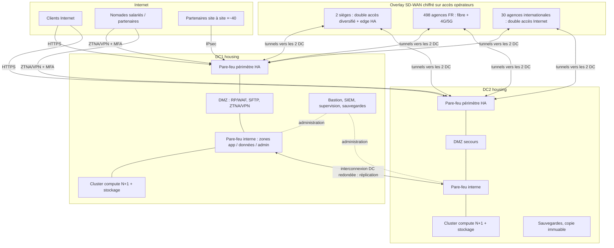
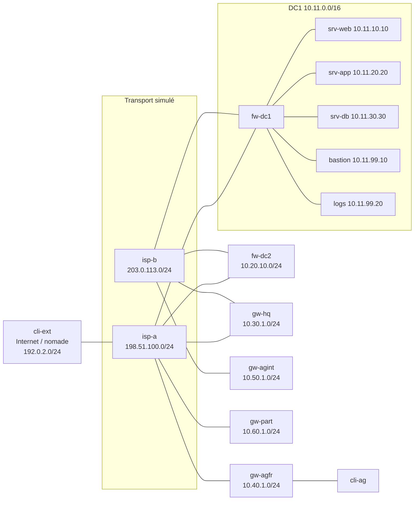

> **Document obsolète (brouillon du 15/10/2026), conservé pour l'historique.** Les schémas HLD à jour sont dans `docs/OFFRE_TECHNIQUE.md` (sections 3, 9 et 10) et dans le diaporama ; la maquette est décrite dans `docs/MAQUETTE.md`.

# HLD — Architecture cible et maquette

État : **brouillon v0.1**, rédigé le 15/10/2026. Le PDF de l'appel d'offres n'a pas encore été relu : les références d'exigences (E01…E16, H1…H5) renvoient à `docs/EXIGENCES.md`. Les choix d'éditeurs et de modèles seront arrêtés à l'étape chiffrage (plan §6, étape 7). Ici, on ne fixe que les fonctions et les profils.

---

## Partie 1 — Architecture cible (530 sites, 10 000 utilisateurs)

### 1.1 Vue d'ensemble

### 1.2 Datacenters (E01, E02)

- **Deux DC en housing**, dans des domaines de panne distincts : alimentation, opérateurs et zone géographique différents. Chaque DC a une alimentation A+B et au moins deux opérateurs Internet/WAN arrivant par des chemins physiques distincts.
- **Interconnexion DC1↔DC2** : deux liens de chemins distincts, pour la réplication et la gestion.
- **Mode de fonctionnement proposé** : actif/actif pour la publication web/API et les accès distants (répartition DNS/GSLB) ; actif/passif pour les bases, par réplication. RPO/RTO à fixer avec le client (H4). Sans ces valeurs, deux DC ne constituent pas un PRA.
- **Compute** : un cluster de virtualisation par DC, dimensionné N+1. Chaque DC doit pouvoir porter seul le périmètre « critique » défini avec le client.
- **Sauvegardes** : règle 3-2-1, avec une copie immuable ou hors ligne et des tests de restauration planifiés.

### 1.3 WAN et profils de sites (E03, E09)

Données dérivées du PDF : environ 8 utilisateurs par agence FR (4 000 / 498) et environ 67 par agence internationale (2 000 / 30). Les débits sont des hypothèses (H1).

| Profil | Quantité | Accès | Équipement | Sortie Internet |
|---|---|---|---|---|
| P1 Siège | 2 | 2 accès fibre dédiés, opérateurs différents, + secours 4G/5G | Paire d'edges SD-WAN/NGFW en HA | Locale filtrée + centrale pour les flux sensibles |
| P2 Agence FR | 498 | 1 fibre pro + secours 4G/5G | 1 edge SD-WAN/NGFW avec modem 4G/5G intégré | Locale filtrée |
| P3 Agence internationale | 30 | 2 accès Internet locaux (ou 1 + 4G/5G selon le pays) | 1 edge SD-WAN/NGFW, HA si plus de ~50 utilisateurs | Locale filtrée, conforme au droit local |
| DC | 2 | 2 transits Internet + concentrateurs SD-WAN | Paire de concentrateurs HA par DC | Centrale |

- **Overlay** : tunnels IPsec de chaque site vers les deux DC (hub & spoke double hub) ; choix du chemin par application selon la qualité mesurée (SLA de latence, gigue, perte).
- **Pas de MPLS imposé** : l'overlay sur Internet réduit les coûts et va dans le sens de la demande d'abonnement. MPLS reste une option pour les sièges si une exigence de SLA de bout en bout apparaît.
- **Segmentation dans chaque site** : utilisateurs, invités (Internet seulement), administration, VoIP/IoT selon l'inventaire du client.

### 1.4 Nord/sud et publication (E04, E06, E07, E08)

- **Pare-feu périmètre HA** par DC, avec DMZ dédiée.
- **Web/API** : reverse proxy + WAF en DMZ, TLS terminé sur le RP, ré-chiffrement vers les applications. Une protection DDoS volumétrique est souscrite auprès de l'opérateur de transit.
- **FTP** : migration vers **SFTP** (de préférence) ou FTPS, via une passerelle de transfert en DMZ. Le FTP en clair n'est maintenu qu'en exception isolée, documentée et limitée dans le temps.
- **Sorties Internet** : filtrage par catégories, inspection selon la politique du client, journalisation centralisée.

### 1.5 Est/ouest (E05)

Zones : `DMZ` → `applications` → `données`, plus `administration` et `partenaires`. Toutes les règles sont en refus par défaut et chaque flux autorisé est documenté (voir `docs/FLUX.md`). Le filtrage inter-zones passe par un pare-feu interne (ou des contextes virtuels séparés sur la même plateforme) ; une micro-segmentation dans l'hyperviseur est possible en option.

### 1.6 Accès distants (E11, E12, E13)

| Population | Mécanisme | Contrôle |
|---|---|---|
| Salariés nomades (sur 10 000 comptes) | ZTNA, ou VPN SSL/IPsec en transition | IdP central + MFA, droits par groupe et par application, contrôle de posture du poste |
| Partenaires site à site (~40 % des ~100) | IPsec terminé dans une **zone partenaire** du DC | Accès limité aux applications contractuelles, NAT des préfixes partenaires si chevauchement |
| Partenaires nomades (~60 %) | Accès applicatif ZTNA ou portail, comptes partenaires distincts | MFA, durée de vie des comptes, revue trimestrielle, révocation immédiate |

Un VPN seul ne constitue pas du ZTNA : l'offre précisera ce que fait réellement le produit retenu.

### 1.7 Infogérance et exploitation (E10)

- **Bastion / PAM** : accès nominatif avec MFA, approbation et durée limitée, enregistrement des sessions. L'accès direct aux équipements depuis l'extérieur est interdit.
- **SIEM / collecte de journaux** centralisée, avec rétention selon les obligations du client.
- **Supervision** des 530 sites et des deux DC.
- **Services socles** : DNS, NTP, gestion de configuration et des mises à jour.

---

## Partie 2 — Maquette EVE-NG (démonstrateur)

Source unique : `inventory/topology.yml` et `inventory/addressing.csv`.

### Correspondance cible → maquette

| Cible | Maquette | Ce qui est prouvé | Ce qui ne l'est pas |
|---|---|---|---|
| 2 DC | fw-dc1 + zones, fw-dc2 | Routage et bascule de chemin vers DC2 | Résilience physique, réplication des données (phase d'extension) |
| SD-WAN 530 sites | gw-hq, gw-agfr, gw-agint en IPsec sur 2 transports | Chiffrement, double hub, bascule sur perte de transport | Pilotage applicatif SD-WAN, orchestration centrale, volumétrie |
| Nord/sud, DMZ | isp-a → fw-dc1 → srv-web | Exposition HTTPS seule, refus de l'accès direct à la base | WAF en charge, DDoS |
| Est/ouest | Zones dmz/app/data/adm | Matrice de flux et tests négatifs | Micro-segmentation hyperviseur |
| Nomades / partenaires | cli-ext (rôles successifs), gw-part | Tunnel, droits distincts, refus hors périmètre | MFA et ZTNA tant que l'IdP n'est pas ajouté (extension) |
| Infogérance | bastion, logs | Passage obligé par le bastion, traces centralisées | PAM commercial (approbation, enregistrement vidéo) |

Ressources : 15 nœuds, environ 12–16 Go de RAM au total. Ils sont démarrés par lots dans la VM EVE (~22 Go), sur PAR861454.
