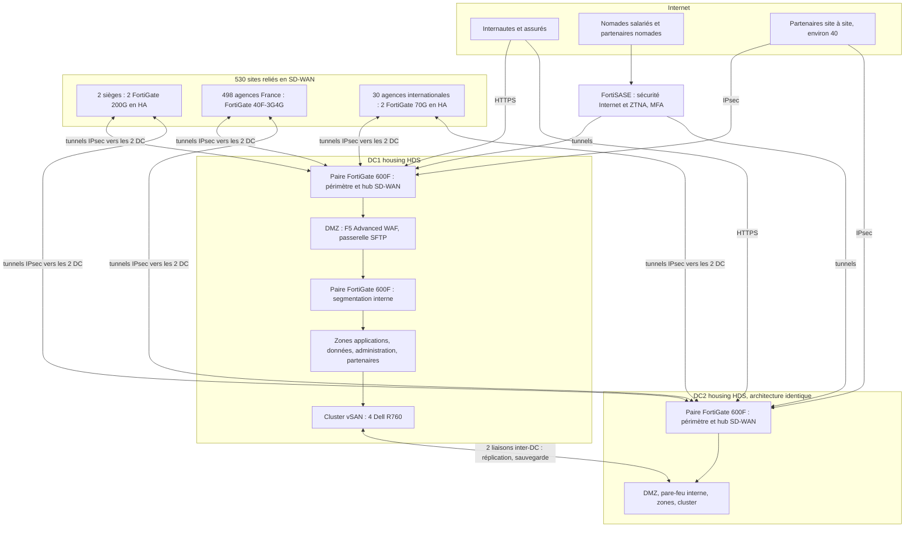
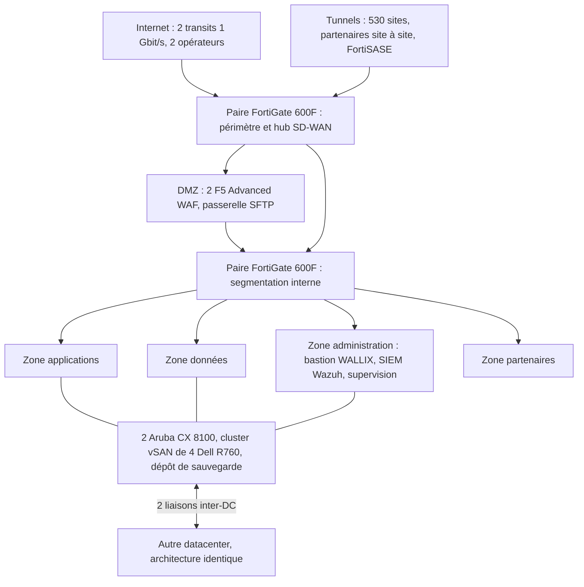

# Offre technique et financière — Sécurité des infrastructures d'une mutuelle santé

Réponse à l'appel d'offres « Sécurité des infrastructures » · **Version 1.0 du 28 octobre 2026** · Montants en euros hors taxes (HT).

Documents associés :
- `docs/EXIGENCES.md` : matrice des exigences du PDF et des hypothèses ;
- `docs/FLUX.md` : matrice des flux autorisés et refusés ;
- `docs/CHIFFRAGE.md` : chiffrage ligne à ligne avec les sources de prix. **Il fait foi pour tous les montants** ;
- `evidence/20261016T181400Z/` : preuves de la maquette (recette, journaux, bascule WAN, empreintes SHA-256) ;
- les schémas HLD (global, datacenter, agences, accès distants) du diaporama de soutenance : https://claude.ai/artifact/957Rryu9hkuprq9MUcjuns.

## Sommaire

1. Synthèse exécutive
2. Compréhension du besoin et hypothèses
3. Architecture globale (HLD)
4. Connectivité WAN
5. Housing datacenter
6. Compute et sauvegarde
7. Sécurité nord/sud et publication
8. Sécurité est/ouest
9. HLD datacenter
10. HLD agences : réseau et sécurité
11. Administration distante et infogérance
12. Nomadisme des collaborateurs (dont le choix du ZTNA)
13. Accès partenaires
14. Exploitation
15. Modèles retenus, quantités et justification
16. Coûts globaux et abonnement
17. Phasage du déploiement
18. Maquette de validation et limites
19. Risques, conformité et exclusions

Annexe A. Glossaire · Annexe B. Sources

---

## 1. Synthèse exécutive

**Le besoin.** Une grande mutuelle santé veut bâtir une nouvelle architecture sécurisée pour ses datacenters et ses 530 sites : 2 sièges, 498 agences en France et 30 agences à l'international, soit 10 000 utilisateurs, plus une centaine de partenaires. Elle traite des données de santé et ne peut pas engager une grosse somme d'un coup.

**Notre réponse en cinq points.**

1. **Un réseau étendu SD-WAN Fortinet sur Internet.** Chaque site reçoit un pare-feu FortiGate qui le relie aux deux datacenters par des tunnels chiffrés et bascule seul d'un accès Internet à l'autre en cas de panne (3,8 s mesurées sur notre maquette). Pas de MPLS : c'est moins cher, cela se souscrit au mois, et la sécurité ne dépend pas du réseau de l'opérateur.
2. **Deux datacenters en housing certifiés HDS**, en région parisienne, dans des domaines de panne distincts. Chacun héberge un cluster VMware de 4 serveurs Dell R760. La sauvegarde Veeam garde une copie immuable, que même un attaquant ne peut pas effacer.
3. **Une sécurité en profondeur, où tout est refusé par défaut.** Deux paires de pare-feu par datacenter (une en périmètre, une pour la segmentation interne), un pare-feu applicatif (WAF) F5 devant les applications publiées, le FTP remplacé par SFTP, un bastion WALLIX comme seule porte d'administration et un SIEM Wazuh qui centralise les journaux.
4. **Le Zero Trust pour les accès distants.** Les 3 000 nomades et les 300 utilisateurs partenaires passent par FortiSASE : chacun n'atteint que ses applications, après authentification forte (MFA) et contrôle de son poste. Les 40 partenaires site à site arrivent dans une zone qui leur est réservée.
5. **Trois profils de site standardisés** (siège, agence France, agence internationale), réseau local et Wi-Fi Aruba compris, pilotés depuis deux consoles centrales : FortiManager pour les pare-feu, Aruba Central pour les commutateurs et les bornes.

**Le coût.** **221,4 k€ HT par mois pendant 36 mois, tout compris** (matériel, licences, accès réseau, housing, déploiement, infogérance ; exclusions listées en section 16.4), **sans investissement initial**. Cela représente 7,97 M€ sur la durée, soit **22,14 € par utilisateur et par mois** ou 418 € par site et par mois. Le matériel et les licences sont financés par une location financière (taux supposé de 7 % par an). Ce prix est calculé sur des prix publics : une remise de 20 %, courante sur ce volume, le ramènerait à 195,3 k€ par mois.

**Ce qui distingue l'offre.**
- Chaque choix est justifié face à une alternative (section 15). Par exemple, nous utilisons le ZTNA compris dans la souscription utilisateur FortiSASE, ce qui évite 1,99 M€ bruts par rapport à Zscaler ZPA, et au moins 1,5 M€ une fois ajoutées les licences des 4 FortiGate hubs (section 12.3).
- L'architecture est éprouvée sur maquette : 17 flux sur 17 conformes (autorisations et refus) et une bascule WAN en 3,8 s.
- La conformité est intégrée dès la conception : HDS, DORA (plan de réversibilité), RGPD.

**À confirmer avec le client** : objectifs de reprise après sinistre (RPO/RTO), pays des agences internationales, nombre réel de nomades et de comptes à privilèges, plan de câblage des sièges (étage de distribution à dimensionner). Les prix sont des prix publics ou des estimations sourcées, à confirmer par devis.

---

## 2. Compréhension du besoin et hypothèses

### 2.1 Périmètre

| Élément | Volume | Source |
|---|---|---|
| Sièges | 2 sites, 4 000 utilisateurs (2 000 par siège, hypothèse H11) | PDF p.1 |
| Agences France | 498 sites, 4 000 utilisateurs (~8 par agence) | PDF p.1 |
| Agences internationales | 30 sites, 2 000 utilisateurs (~67 par agence) | PDF p.1 |
| **Total** | **530 sites, 10 000 utilisateurs** | PDF p.1 |
| Partenaires | ~100 : 40 % en site à site, 60 % en utilisateurs nomades | PDF p.2 |
| Datacenters | 2, en housing | choix de l'offre (section 5) |

### 2.2 Enjeux identifiés

- **Données de santé** : confidentialité renforcée (RGPD, article 9) et hébergement certifié HDS (Hébergeur de Données de Santé).
- **Secteur de l'assurance** : résilience numérique et maîtrise des prestataires informatiques, exigées par le règlement européen DORA.
- **Dispersion géographique** : 530 sites, dont 30 à l'étranger, à déployer et à exploiter à distance. D'où la standardisation et le pilotage central.
- **Ouverture** : applications publiées sur Internet (web, API, FTP), collaborateurs nomades, partenaires. D'où un contrôle d'accès par application plutôt que par réseau.
- **Budget** : « ma DSI ne me permet de débloquer une grosse somme d'un coup ». D'où une offre en abonnement mensuel.

### 2.3 Les trois volets évalués et où les trouver

| Volet du PDF (p.3) | Où dans l'offre |
|---|---|
| Solutions techniques : concept, modèle d'équipement retenu, justification | Sections 4 à 14 (concept et justification par fonction) ; tableau récapitulatif en section 15 |
| Architecture datacenter et agences en schémas HLD | Sections 3 (vue globale), 9 (datacenter) et 10 (agences) ; schémas dans le diaporama |
| Coûts globaux, abonnement, ventilation par poste | Section 16 ; détail ligne à ligne dans `docs/CHIFFRAGE.md` |

### 2.4 Hypothèses

Le PDF ne donne pas tous les paramètres de dimensionnement. Nous affichons nos hypothèses ; le chiffrage est calculé à partir d'elles par un script et se recalcule en une commande si le client les corrige. Détail dans `docs/EXIGENCES.md`.

| ID | Hypothèse | Valeur retenue | Ce qui change si elle est fausse |
|---|---|---|---|
| H1 | Débits par site | Fibre pro en agence France ; 2 × 1 Gbit/s par siège ; 2 accès par agence internationale ; 2 × 1 Gbit/s de transit par datacenter | Coût WAN, modèle de FortiGate |
| H2 | Applications publiées | Non communiquées ; WAF de 1 Gbit/s par instance, 4 instances | Taille des WAF |
| H3 | Pays des agences internationales | Inconnus ; accès chiffrés sur un tarif français de référence | Coût WAN, encadrement RGPD des transferts |
| H4 | Objectifs de reprise (RPO/RTO) et engagements de service | À fixer avec le client | Mode de réplication, capacité du datacenter de secours |
| H6 | Collaborateurs nomades | 3 000 (30 % des utilisateurs) | Licences FortiSASE |
| H7 | Utilisateurs chez les 60 partenaires nomades | 300 (5 par partenaire) | Licences FortiSASE |
| H8 | Machines virtuelles | 300 VM (en moyenne 2 vCPU, 8 Go de mémoire, 150 Go de disque) | Serveurs, licences, sauvegarde |
| H9 | Comptes à privilèges (administrateurs, infogérants) | 50 | Licences du bastion |
| H10 | Volume de journaux | Non communiqué ; SIEM hébergé sur le compute | Ressources du SIEM |
| H11 | Répartition des utilisateurs des sièges | 2 000 par siège | LAN, Wi-Fi, WAN des sièges |
| H12 | Fournisseur d'identité | Existant chez le client, avec MFA (par exemple Microsoft Entra ID) | Sinon, ajouter FortiToken ou FortiAuthenticator (à chiffrer) |

Le numéro H5 n'est pas utilisé (hypothèse retirée en cours d'étude) ; les autres numéros sont conservés car le chiffrage y fait référence.

Règles de dimensionnement : 1,25 port de commutateur par utilisateur ; une borne Wi-Fi pour 25 utilisateurs (une par agence France) ; deux boîtiers en haute disponibilité au-delà de 50 utilisateurs ; 2 % de matériel de remplacement (spare) pour le parc des agences.

### 2.5 Correspondance entre les exigences du PDF et l'offre

| Exigence du PDF | Page | Section de l'offre | Réf. `EXIGENCES.md` |
|---|---|---|---|
| Périmètre : 500 sites en France (2 sièges, 498 agences), 30 agences internationales, 10 000 utilisateurs | p.1 | 2.1 | V1 à V3 |
| Connectivité WAN en datacenter | p.1 | 4.3, 9 | E03 |
| Connectivité WAN sur les sites | p.1 | 4.2, 10 | E03 |
| Solution housing : répartition, redondance | p.1 | 5 | E01 |
| Compute : virtuel ou physique, technologies | p.1 | 6 | E02 |
| Nord/sud : segmentation | p.2 | 7.1, 9 | E04 |
| Publication sur Internet : serveur web, API | p.2 | 7.2 | E07 |
| Publication sur Internet : FTP | p.2 | 7.3 | E08 |
| Sécurité des accès Internet des ressources du datacenter | p.2 | 7.4 | E06 |
| Sécurité des accès Internet pour d'autres usages (utilisateurs ou non) | p.2 | 7.4, 10, 12 | E06 |
| Est/ouest : segmentation et solutions entre réseaux du datacenter | p.2 | 8, 9 | E05 |
| Agences : architecture retenue | p.2 | 3, 10 | E09 |
| Agences : solutions réseaux | p.2 | 10.2 | E17 |
| Agences : solutions de sécurité | p.2 | 10.1, 10.3 | E09 |
| Agences : accès à Internet et aux ressources des datacenters | p.2 | 4, 10.3 | E09 |
| Administration distante : accès d'infogérance | p.2 | 11 | E10 |
| Nomadisme des collaborateurs | p.2 | 12 | E11 |
| Partenaires : 40 % site à site, 60 % nomades ; VPN, ZTNA, authentification, MFA | p.2-3 | 12.3, 13 | E12, E13 |
| Solutions techniques : concept, modèle d'équipement retenu, justification | p.3 | 4 à 14, tableau en 15 | E14 |
| Schémas HLD datacenter et agences | p.3 | 3, 9, 10 + diaporama | E15 |
| Coûts globaux, abonnement ; Housing, Connectivité WAN, Serveurs, Équipements réseau, Équipements de sécurité, Etc. | p.3 | 16 | E16 |

### 2.6 Principes directeurs

1. **Zero Trust** : aucune confiance accordée du seul fait d'être « dans le réseau ». Chaque accès est authentifié, autorisé application par application, et journalisé.
2. **Refus par défaut** : entre deux zones, tout est interdit sauf les flux écrits, justifiés et journalisés dans `docs/FLUX.md`.
3. **Défense en profondeur** : plusieurs barrières successives (pare-feu périmètre, WAF, pare-feu interne, bastion), dont certaines chez des éditeurs différents, pour qu'une seule faille ne suffise pas.
4. **Standardisation** : trois profils de site identiques entre eux, configurés depuis des modèles, pour déployer 530 sites sans erreur manuelle.
5. **Pilotage central** : une console pour les pare-feu, une pour le réseau local et le Wi-Fi, un SIEM pour tous les journaux.
6. **Abonnement** : tous les postes sont présentés en mensualités, sans investissement initial.

---

## 3. Architecture globale (HLD)

L'architecture comprend quatre ensembles.

**1. Deux datacenters en housing (DC1 et DC2), de conception identique.** Dans chacun, le trafic traverse dans l'ordre : une paire de pare-feu FortiGate 600F de périmètre, qui sert aussi de concentrateur (hub) pour les tunnels des sites ; une DMZ qui porte les services publiés (WAF F5, passerelle SFTP) ; une seconde paire de FortiGate 600F qui sépare les zones internes (applications, données, administration, partenaires) ; enfin le cluster de virtualisation (4 serveurs Dell R760 sous VMware). Deux liaisons inter-DC, sur des chemins physiques distincts, portent la réplication et la sauvegarde.

**2. Un réseau étendu SD-WAN qui relie les 530 sites aux deux datacenters.** Chaque site (2 sièges, 498 agences France, 30 agences internationales) dispose d'au moins deux accès (fibre et 4G, ou deux fibres) et d'un ou deux FortiGate. Le FortiGate monte des tunnels IPsec chiffrés vers les deux datacenters sur chacun de ses accès. Il donne aussi l'accès à Internet localement, après filtrage.

**3. Des accès distants contrôlés.** Les nomades salariés et les utilisateurs partenaires nomades se connectent à FortiSASE, un service de sécurité dans le cloud : il filtre leur navigation Internet et leur ouvre, après MFA, les seules applications auxquelles ils ont droit (ZTNA). Les partenaires site à site montent un tunnel IPsec qui aboutit dans une zone partenaire du datacenter. Les internautes et les assurés atteignent les applications publiées en HTTPS, à travers le WAF.

**4. Un plan d'administration et d'exploitation séparé.** Toute administration passe par le bastion WALLIX. Les journaux de tous les équipements vont au SIEM Wazuh. Les FortiGate sont pilotés par FortiManager Cloud, les commutateurs et les bornes Wi-Fi par Aruba Central.

**Les principaux flux** (le détail des ports est dans `docs/FLUX.md`) :

| Qui | Vers quoi | Chemin |
|---|---|---|
| Utilisateur en agence ou au siège | Application du datacenter | FortiGate du site → tunnel IPsec → pare-feu périmètre → pare-feu interne → zone applications |
| Utilisateur en agence ou au siège | Internet | Sortie locale filtrée par le FortiGate du site |
| Internaute, assuré | Site web, API | Internet → pare-feu périmètre → WAF F5 en DMZ → pare-feu interne → application |
| Partenaire en transfert de fichiers | Passerelle SFTP | Internet → pare-feu périmètre → passerelle SFTP en DMZ |
| Collaborateur ou partenaire nomade | Application autorisée | Poste → FortiSASE (MFA, contrôle du poste) → tunnel → datacenter → application |
| Partenaire site à site | Application contractuelle | Tunnel IPsec → zone partenaire → application autorisée |
| Administrateur, infogérant | Équipement ou serveur | FortiSASE → bastion WALLIX (MFA, session enregistrée) → équipement |
| Serveurs du datacenter | Internet (mises à jour) | Sortie centrale filtrée par le pare-feu périmètre |

---

## 4. Connectivité WAN

### 4.1 Principe

Le SD-WAN (réseau étendu piloté par logiciel) répartit le trafic de chaque site sur plusieurs accès Internet. Pour chaque application, il choisit le meilleur accès selon la qualité mesurée en continu (latence, gigue, perte de paquets) et bascule automatiquement si un accès tombe. Chaque site monte des tunnels IPsec chiffrés **vers les deux datacenters**, sur chacun de ses accès (architecture « double hub »).

**Pas de MPLS.** Un réseau MPLS d'opérateur coûte plus cher, se commande avec des délais longs et ne chiffre pas les données. L'Internet professionnel se souscrit au mois, chez plusieurs opérateurs ; la sécurité repose sur le chiffrement et les pare-feu, pas sur le réseau de l'opérateur. Le MPLS reste possible en option pour les sièges si un engagement de bout en bout était exigé.

### 4.2 Connectivité des sites

| Profil | Accès | Équipement SD-WAN |
|---|---|---|
| 2 sièges (~2 000 utilisateurs chacun) | 2 fibres dédiées FTTO 1 Gbit/s chez 2 opérateurs différents + carte SIM 4G/5G de secours | 2 FortiGate 200G en haute disponibilité (HA) |
| 498 agences France (~8 utilisateurs) | 1 fibre professionnelle FTTH (garantie de temps d'intervention de 8 h) + carte SIM 4G de secours insérée dans le FortiGate | 1 FortiGate 40F-3G4G (modem 4G intégré) |
| 30 agences internationales (~67 utilisateurs) | 2 accès Internet locaux | 2 FortiGate 70G en HA |

**Pourquoi ces modèles :**
- **FortiGate 40F-3G4G en agence France** : le modem 4G est intégré, donc un seul boîtier fait pare-feu, SD-WAN et secours cellulaire. Il inspecte jusqu'à 600 Mbit/s en protection complète (fiche constructeur), largement assez pour 8 utilisateurs. Une agence de cette taille tolère une courte coupure : en cas de panne, le boîtier est remplacé depuis le stock de spare (10 boîtiers), sans second équipement sur place.
- **FortiGate 70G en HA à l'international** : avec ~67 utilisateurs et un site éloigné du stock de spare, une panne de boîtier couperait l'agence plusieurs jours. Notre règle : au-delà de 50 utilisateurs, deux boîtiers.
- **FortiGate 200G en HA au siège** : 6 Gbit/s inspectés en protection complète (fiche constructeur) pour 2 000 utilisateurs et deux accès de 1 Gbit/s, avec de la marge. Dimensionnement à confirmer avec les débits réels (H1).

### 4.3 Connectivité des datacenters

| Élément | Choix |
|---|---|
| Accès Internet | 2 transits Internet 1 Gbit/s par datacenter, chez 2 opérateurs différents |
| Liaison entre datacenters | 2 liaisons 1 Gbit/s sur des chemins physiques distincts |
| Concentrateurs SD-WAN (hubs) | La paire de FortiGate 600F de périmètre de chaque datacenter |

**Dimensionnement des hubs** : 530 sites × 2 accès donnent environ 1 060 tunnels par hub, plus 40 tunnels de partenaires site à site, soit environ 1 100. Un FortiGate 600F en accepte 2 000 (fiche constructeur).

### 4.4 Justification du choix : Fortinet Secure SD-WAN et FortiGate

| Critère | Ce que nous apporte Fortinet |
|---|---|
| Sécurité | Le SD-WAN est intégré au pare-feu de nouvelle génération (NGFW) : chaque site inspecte localement son trafic (prévention d'intrusion, antivirus, filtrage web). Abonnement UTP (Unified Threat Protection) inclus pour 3 ans. |
| Coût | Boîtiers et abonnements de sécurité vendus en lots de 3 ans à prix public connu (sources dans `docs/CHIFFRAGE.md`) ; pas de surcoût lié à la bande passante qui transite par un cloud tiers. |
| Exploitation | 570 FortiGate configurés depuis une seule console (FortiManager Cloud), par modèles de configuration ; un seul système et un seul moteur d'inspection, des agences jusqu'aux datacenters. |
| Conformité | Le trafic des sites va directement aux datacenters de la mutuelle, chiffré de bout en bout, sans passer par la plateforme d'un tiers. |
| Abonnement | Lots de 3 ans intégrés à la location financière : aucune avance. |
| Reconnaissance | Fortinet est classé « Leader » par Gartner pour le SD-WAN (2024, cinquième année consécutive, selon Fortinet) et pour les pare-feu (Magic Quadrant 2026 « Hybrid Mesh Firewall ») ; pour le SASE, il est « Challenger » en 2026, après « Leader » en 2025 (sources en annexe B). |

**Alternatives écartées :**
- **Cato Networks (SASE entièrement dans le cloud)** : solution reconnue (« Leader » Gartner SASE 2026), mais tout le trafic des sites transite par les points de présence de Cato, ce qui dépend de cette plateforme pour chaque flux et ajoute un tiers sur le chemin des données de santé. Les prix ne sont pas publics.
- **Peplink en agence** : très bon pour l'agrégation de liens cellulaires, mais avec des fonctions de sécurité plus limitées ; il aurait fallu un second boîtier pare-feu par agence.
- **MPLS** : voir 4.1.

### 4.5 Preuve sur maquette

Coupure de l'opérateur A d'une agence : le trafic bascule sur l'opérateur B en **3,8 s** (19 paquets perdus à raison d'un paquet toutes les 0,2 s), puis revient automatiquement sur A à son rétablissement (`evidence/20261016T181400Z/bascule_wan.txt`).

---

## 5. Housing datacenter

### 5.1 Solution

**Deux datacenters en colocation (housing), en région parisienne, dans deux domaines de panne distincts** : bâtiments, alimentations électriques et opérateurs différents. La mutuelle loue l'espace, l'énergie et la climatisation ; elle reste propriétaire (via la location financière) de ses équipements.

| Élément | Par datacenter |
|---|---|
| Espace | 2 baies 42U |
| Puissance | 6 kW, double alimentation électrique (voies A et B) |
| Opérateurs | Datacenter neutre (« carrier-neutral ») : au moins 2 opérateurs, arrivant par des chemins distincts |
| Niveau de disponibilité | Tier III (maintenance possible sans coupure) |
| Certification | HDS (référentiel en vigueur), vérifiée auprès de l'organisme certificateur |

**Répartition et redondance.**
- **Publication web/API et accès distants : actif/actif.** Les deux datacenters servent en même temps ; la répartition se fait par le DNS. Si l'un tombe, l'autre continue de servir ces accès.
- **Bases de données : actif/passif.** Le datacenter principal réplique ses données vers l'autre ; en cas de sinistre, le second prend le relais. Les objectifs RPO (perte de données maximale acceptable) et RTO (durée d'interruption maximale) restent à fixer avec le client (H4) ; ils déterminent le mode de réplication.
- Dans chaque datacenter, chaque élément est doublé : pare-feu en paire, commutateurs en paire, 4 serveurs pour un besoin de 3, deux alimentations électriques.

### 5.2 Justification

| Critère | Argument |
|---|---|
| Sécurité et continuité | Deux sites distincts : après la perte complète d'un datacenter, l'autre reprend le périmètre critique (section 6.1). C'est aussi ce qu'attend DORA en matière de continuité. |
| Coût | Le housing se paie au mois (baie, énergie) : pas d'investissement immobilier. Prix de référence : 470,40 € HT par baie et par mois hors énergie, plus l'énergie (1 314,66 € par mois et par datacenter), soit 4 511 € par mois au total. |
| Exploitation | La région parisienne concentre les opérateurs et les hébergeurs ; elle est proche des sièges pour les interventions ; la faible distance permet une réplication rapide. |
| Conformité | La certification HDS est exigée de l'hébergeur (le référentiel HDS en vigueur impose un hébergement physique dans l'Espace économique européen). |
| Abonnement | Contrat mensuel. |

**Alternatives écartées :**
- **Datacenter détenu par la mutuelle** : investissement lourd, contraire à la demande d'abonnement.
- **Cloud public (IaaS)** : hors de la demande du PDF (housing) ; il pose aussi la question des lois extra-européennes pour les grands fournisseurs.
- **Deux datacenters dans deux régions éloignées** : meilleure protection contre un sinistre régional, mais réplication plus lente et liaisons plus chères. Nous le proposons en option si l'analyse de risques du client l'exige ; à défaut, nous choisirons deux sites hors zone inondable.

**Point de vigilance** : le prix de référence de la baie provient d'un hébergeur dont la certification HDS n'est pas établie. Le surcoût éventuel d'un hébergeur certifié HDS est listé dans les postes non inclus (section 16.4).

---

## 6. Compute et sauvegarde

### 6.1 Solution

**Virtualisation VMware vSphere Foundation (VVF) sur serveurs Dell PowerEdge R760**, en cluster hyperconvergé : les disques des serveurs forment un stockage partagé (vSAN), sans baie de stockage séparée.

| Élément | Par datacenter |
|---|---|
| Serveurs | 4 Dell R760 (2 processeurs de 32 cœurs, 512 Go de mémoire, disques SSD) |
| Redondance | N+1 : la charge tient sur 3 serveurs, le quatrième permet de perdre ou de mettre en maintenance un serveur sans perte de capacité utile |
| Stockage | vSAN en RAID 5 (codage d'effacement), inclus dans la licence VVF : 0,25 TiB par cœur, soit 64 TiB par datacenter |
| Charge | 300 VM au total (H8) ; chaque datacenter porte sa production et une réplique de celle de l'autre |
| Commutation | 2 commutateurs Aruba CX 8100 en haut de baie |

**Virtuel ou physique ?** Virtuel par défaut : meilleure utilisation du matériel, redémarrage automatique d'une VM sur un autre serveur en cas de panne, sauvegarde et réplication plus simples. Le physique est réservé aux cas imposés par un éditeur de logiciel.

**Capacité en cas de perte d'un datacenter : le plan de reprise porte sur le périmètre critique, pas sur la totalité.** Les 300 VM demandent 2,4 To de mémoire (300 × 8 Go) ; un datacenter n'en a que 2 To (4 × 512 Go), dont 1,5 To en fonctionnement N+1. Le datacenter restant redémarre donc le **périmètre critique**, à définir avec le client en même temps que ses objectifs RPO/RTO (H4) ; les autres VM attendent le retour du site perdu. Si les 300 VM doivent toutes tourner sur un seul site, il faut ajouter des serveurs dans chaque datacenter (non chiffré).

### 6.2 Sauvegarde

**Veeam Data Platform** selon la règle 3-2-1 (trois copies, sur deux supports, dont une hors site) :
- un dépôt de sauvegarde local dans chaque datacenter (1 serveur de 12 × 20 To par datacenter), qui reçoit les sauvegardes de l'autre site ;
- une **copie immuable** chez un fournisseur français de stockage objet (68 To) : une fois écrite, elle ne peut être ni modifiée ni supprimée pendant sa durée de rétention, même avec des droits d'administrateur. C'est la parade au rançongiciel, qui cherche d'abord à détruire les sauvegardes ;
- des restaurations de test planifiées, car une sauvegarde jamais restaurée n'est pas une sauvegarde.

Comme l'hébergeur, le fournisseur de stockage objet doit être certifié HDS : les sauvegardes contiennent des données de santé.

### 6.3 Justification

| Choix | Pourquoi | Alternative écartée et raison |
|---|---|---|
| VMware vSphere Foundation | Hyperviseur le plus répandu en entreprise : compétences faciles à trouver, compatibilité avec les éditeurs, support. VVF inclut le stockage vSAN, évitant une baie de stockage. Abonnement par cœur et par an, cohérent avec la demande. | **VMware Cloud Foundation (VCF)** : plus cher ; il apporte la micro-segmentation NSX, inutile ici puisque la segmentation est faite par une paire de pare-feu dédiée (section 8). **Proxmox VE** : licence moins chère, mais support et écosystème moins étoffés pour 300 VM critiques ; il reste notre **solution de sortie** si les prix VMware dérivent (Veeam le prend en charge depuis sa version 12.2). **Nutanix** : solution hyperconvergée équivalente, sans avantage décisif et sans prix public relevé. |
| Dell PowerEdge R760 | Serveur standard 2U à deux processeurs, prix public relevé, adapté à vSAN. | **HPE ProLiant DL380 Gen11** : équivalent fonctionnel ; la marque sera remise en concurrence au moment du devis. |
| Veeam | Référence du marché, sauvegarde immuable, compatible avec VMware et avec Proxmox, donc indépendant d'un changement d'hyperviseur. Abonnement annuel. | **Sauvegarde proposée par l'hébergeur** : dépendance supplémentaire à l'hébergeur et moindre maîtrise des restaurations. |

---

## 7. Sécurité nord/sud et publication

Le trafic « nord/sud » est celui qui entre dans le datacenter ou en sort (Internet, sites, partenaires).

### 7.1 Segmentation nord/sud

- **Pare-feu de périmètre** : une paire de FortiGate 600F en haute disponibilité par datacenter, avec prévention d'intrusion (IPS), antivirus et contrôle applicatif. Elle sert aussi de concentrateur SD-WAN (section 4.3).
- **DMZ** (zone démilitarisée) : zone tampon qui reçoit seule les connexions venant d'Internet. Elle contient les WAF et la passerelle SFTP. Aucun serveur applicatif ni aucune base n'est joignable directement depuis Internet.
- Derrière la DMZ, la seconde paire de pare-feu (section 8) filtre chaque passage vers les zones internes.

### 7.2 Publication des applications web et des API

**F5 BIG-IP Advanced WAF** (édition virtuelle, 1 Gbit/s, 2 instances par datacenter, en abonnement mensuel), devant les applications web et les API :
- terminaison du chiffrement TLS dans le datacenter, puis rechiffrement vers l'application ;
- protection contre les attaques web courantes (catalogue OWASP : injection, vol de session…) et protection des API (contrôle du format des requêtes, limitation de débit) ;
- répartition de charge entre les serveurs d'application.

**Pourquoi F5** : référence du marché pour la publication applicative ; le WAF tourne sur nos serveurs, donc le trafic des assurés est déchiffré dans les datacenters certifiés HDS, et nulle part ailleurs ; abonnement mensuel ; éditeur différent de celui des pare-feu, si bien qu'une même faille ne peut pas ouvrir les deux barrières.

**Alternatives écartées** : un **WAF en cloud** (par exemple Cloudflare) déchiffrerait le trafic des assurés, données de santé comprises, hors du périmètre HDS et chez un acteur soumis à une loi extra-européenne ; **FortiWeb** (le WAF de Fortinet) aurait accru la dépendance à un seul éditeur et supprimé la diversité entre les deux barrières.

### 7.3 Remplacement du FTP

Le FTP transmet identifiants et fichiers en clair. Il est remplacé par une **passerelle SFTP** en DMZ : chiffrement, authentification par clé, liste des adresses autorisées par partenaire, comptes cloisonnés dans leur répertoire. Un partenaire qui ne sait faire que du FTP bénéficie d'une exception temporaire, isolée, journalisée et datée.

### 7.4 Sécurité des accès Internet

| Population | Solution |
|---|---|
| Serveurs du datacenter | Sortie centrale par le pare-feu de périmètre, limitée aux destinations nécessaires (mises à jour, API externes), filtrée par catégorie et réputation, journalisée |
| Utilisateurs en agence et au siège | Sortie locale filtrée par le FortiGate du site (filtrage web, antivirus, prévention d'intrusion) : le trafic Internet ne remonte pas inutilement aux datacenters |
| Invités en agence | Réseau Wi-Fi séparé, accès à Internet seulement, aucun accès interne |
| Nomades | Filtrage par FortiSASE, où qu'ils soient (section 12) |

### 7.5 Attaques par saturation (DDoS)

La protection contre les attaques volumétriques se souscrit auprès des opérateurs de transit. C'est une **option non chiffrée** (section 16.4).

### 7.6 Preuves sur maquette

Publication HTTPS et SFTP joignables depuis Internet (F01, F02) ; base de données et bastion non joignables depuis Internet (N01, N02). Les refus sont journalisés lorsque le paquet traverse le pare-feu (N01) ; le bastion, lui, n'est même pas routé depuis Internet : la tentative N02 n'atteint aucun pare-feu, donc ne laisse pas de trace.

---

## 8. Sécurité est/ouest

Le trafic « est/ouest » circule entre les zones internes du datacenter. C'est par là qu'un attaquant ayant pris pied sur un serveur tente de s'étendre.

### 8.1 Segmentation

| Zone | Contenu | Peut joindre |
|---|---|---|
| DMZ | WAF, passerelle SFTP | La zone applications, sur les seuls ports applicatifs |
| Applications | Serveurs d'application | La zone données, sur le seul port de la base |
| Données | Bases de données | Rien à l'initiative de la zone, sauf la réplication vers l'autre datacenter |
| Administration | Bastion, SIEM, supervision | Les équipements, depuis le bastion uniquement |
| Partenaires | Arrivée des tunnels des partenaires site à site | Les seules applications contractuelles |

Une **seconde paire de FortiGate 600F par datacenter** filtre tous les passages entre ces zones. Tout est **refusé par défaut** ; chaque flux autorisé est documenté (source, destination, port, justification) et journalisé dans le SIEM. La matrice complète est dans `docs/FLUX.md`.

### 8.2 Justification

**Pourquoi une paire de pare-feu dédiée plutôt que les pare-feu de périmètre** : une erreur de configuration ou une faille sur le périmètre n'ouvre pas les zones internes ; la charge de la segmentation interne ne ralentit pas le trafic Internet ; même moteur et même console que le reste du parc.

**Alternatives écartées :**
- **Contextes virtuels (VDOM) sur la seule paire de périmètre** : 4 boîtiers de moins, soit 138 820 € de frais initiaux en moins (prix unitaire du chiffrage), mais on perd la séparation physique entre périmètre et cœur. Nous jugeons cette économie trop faible face au risque, pour des données de santé.
- **Micro-segmentation dans l'hyperviseur (VMware NSX)** : filtrage au niveau de chaque VM, plus fin, mais vendu avec VMware Cloud Foundation, plus cher que VVF. Il reste une évolution possible.

### 8.3 Preuves sur maquette

Le serveur web n'atteint l'application que sur le port 8443, l'application n'atteint la base que sur le port 5432 (F03, F04) ; serveur web vers base, et application vers base sur un autre port, sont refusés (N03, N04).

---

## 9. HLD datacenter

Chaque datacenter suit le même schéma, du haut (Internet) vers le bas (serveurs) :

1. **Arrivées** : 2 transits Internet de 1 Gbit/s chez 2 opérateurs, les tunnels SD-WAN des 530 sites, les tunnels des partenaires site à site, les tunnels FortiSASE des nomades.
2. **Paire de FortiGate 600F de périmètre et hub SD-WAN**, en haute disponibilité.
3. **DMZ** : 2 instances F5 BIG-IP Advanced WAF, passerelle SFTP.
4. **Paire de FortiGate 600F de segmentation interne**, en haute disponibilité.
5. **Zones** : applications, données, administration (bastion WALLIX, SIEM Wazuh, supervision), partenaires.
6. **Infrastructure** : 2 commutateurs Aruba CX 8100, cluster vSAN de 4 serveurs Dell R760, 1 serveur de dépôt de sauvegarde.
7. **Liaison avec l'autre datacenter** : 2 liaisons inter-DC sur des chemins distincts (réplication, sauvegarde croisée).

| Composant | Redondance |
|---|---|
| Accès Internet | 2 opérateurs par datacenter, plus le second datacenter |
| Pare-feu | 2 paires en HA par datacenter |
| WAF | 2 instances par datacenter, actif/actif entre datacenters |
| Commutation | 2 commutateurs de cœur par datacenter |
| Serveurs | N+1 (4 serveurs pour un besoin de 3) |
| Énergie | Voies A et B dans chaque baie |
| Données | Réplication vers l'autre datacenter et copie immuable hors site |

---

## 10. HLD agences : réseau et sécurité

### 10.1 Trois profils standardisés

| | Siège (×2, ~2 000 utilisateurs chacun) | Agence France (×498, ~8 utilisateurs) | Agence internationale (×30, ~67 utilisateurs) |
|---|---|---|---|
| Sécurité et SD-WAN | 2 FortiGate 200G (HA) | 1 FortiGate 40F-3G4G | 2 FortiGate 70G (HA) |
| Commutation | 53 Aruba CX 6100 48G PoE + cœur de 2 Aruba CX 8100 | 1 Aruba CX 6100 12G PoE | 2 Aruba CX 6100 48G PoE |
| Wi-Fi 6E | 80 bornes Aruba AP-615 RW | 1 borne AP-615 RW | 3 bornes AP-615 RW |
| Accès WAN | 2 fibres FTTO + 4G/5G | Fibre FTTH + 4G | 2 accès Internet |

Les quantités découlent des règles de la section 2.4 (1,25 port par utilisateur, une borne pour 25 utilisateurs). La borne retenue est l'**Aruba AP-615 en version RW (« reste du monde », référence R7J49A)**, homologuée pour l'Europe. Le PoE (alimentation électrique par le câble réseau) alimente les bornes Wi-Fi et les téléphones sans prise supplémentaire.

### 10.2 Solutions réseau (LAN et Wi-Fi)

- **Segmentation dans chaque site** en réseaux séparés : utilisateurs, invités (Internet seulement), administration, téléphonie et imprimantes. Le FortiGate filtre les échanges entre ces réseaux.
- **Wi-Fi** : un réseau d'entreprise où chaque utilisateur s'authentifie avec son compte (802.1X, via le fournisseur d'identité de la mutuelle) et un réseau invités isolé.
- **Pilotage central** : FortiManager pour les FortiGate, Aruba Central pour les commutateurs et les bornes. Un nouveau site se configure à partir du modèle de son profil.
- **Limite connue, à dimensionner : la distribution des sièges.** Chaque siège compte 53 commutateurs d'accès. Raccordés chacun aux deux cœurs (double attachement), ils demandent 53 ports par cœur, alors qu'un Aruba CX 8100 24XF4C n'offre que 24 ports SFP+. Il faut donc ajouter un étage de distribution (par exemple des commutateurs d'agrégation par bâtiment ou par étage, ou des piles de commutateurs d'accès) ou retenir un cœur de plus forte densité. Le choix dépend du plan de câblage des sièges ; il n'est pas chiffré dans cette offre (section 16.4).

### 10.3 Sécurité et accès des utilisateurs

- **Accès aux datacenters** : par les tunnels IPsec du FortiGate vers les deux datacenters (section 4).
- **Accès à Internet** : sortie locale, filtrée par le FortiGate (filtrage web, antivirus, prévention d'intrusion).
- **Aucune administration directe** : les équipements du site ne s'administrent que depuis le bastion.

### 10.4 Justification du réseau local : Aruba

| Critère | Argument |
|---|---|
| Sécurité | Authentification 802.1X et séparation des réseaux natives ; Wi-Fi 6E avec chiffrement WPA3. |
| Coût | Prix publics relevés pour chaque référence (`docs/CHIFFRAGE.md`). |
| Exploitation | Une seule console cloud (Aruba Central) pour les 672 commutateurs et les 748 bornes ; déploiement sans intervention de configuration sur place. |
| Conformité | Les données métier ne transitent pas par la console : elle ne porte que la configuration et la supervision. |
| Abonnement | Licences Aruba Central de 3 ans, intégrées à la location. |
| Reconnaissance | HPE Aruba Networking est classé « Leader » par Gartner pour l'infrastructure LAN filaire et sans fil pour la 19e année consécutive (2025, selon HPE). |

**Alternatives écartées :**
- **Cisco Catalyst et Meraki** : équivalents fonctionnels, sans avantage décisif pour ce projet.
- **FortiSwitch et FortiAP** (Fortinet) : intégration poussée avec les FortiGate, mais la totalité du réseau dépendrait alors d'un seul éditeur. Garder le réseau local chez un autre éditeur limite ce risque de concentration, que DORA demande de maîtriser.

### 10.5 Preuves sur maquette

L'agence joint l'application du datacenter par le tunnel (F05) ; les invités n'ont accès qu'à Internet (F13) et à aucun réseau interne (N05) ; pas de SSH direct vers les serveurs depuis l'agence (N08).

---

## 11. Administration distante et infogérance

### 11.1 Architecture

- **Bastion WALLIX** : seule porte d'administration de tous les équipements et serveurs. Comptes nominatifs, **MFA**, accès accordé après approbation et pour une durée limitée, **enregistrement des sessions** (rejouables en cas d'enquête). Les mots de passe des équipements restent dans le bastion : l'administrateur ne les connaît pas.
- **Chemin d'accès** : les administrateurs et les infogérants se connectent par FortiSASE (ZTNA) **vers le bastion uniquement**. Aucun accès direct aux équipements, ni depuis Internet ni depuis les sites. Hypothèse : leurs licences FortiSASE sont comprises dans les 3 300 utilisateurs.
- **Traçabilité** : connexions et sessions du bastion envoyées au SIEM.
- **Infogérance incluse** : centre de supervision réseau et sécurité (NOC/SOC) en heures ouvrées, 3 équivalents temps plein. Un SOC 24 h/24 et 7 j/7 est proposé en option, non chiffrée.

### 11.2 Justification : WALLIX Bastion

| Critère | Argument |
|---|---|
| Sécurité | Enregistrement et contrôle des sessions, coffre-fort de mots de passe, MFA. Le produit a obtenu la certification CSPN de l'ANSSI (version 6.0, 2019) ; la certification de la version livrée sera vérifiée. |
| Coût | 50 comptes à privilèges (H9), estimation sur fourchette publique, devis requis. |
| Exploitation | Déployé en machines virtuelles sur notre cluster ; s'appuie sur le fournisseur d'identité existant pour le MFA. |
| Conformité | Éditeur français : pas de loi extra-européenne sur l'outil qui détient les accès les plus sensibles ; les traces d'administration répondent aux exigences d'audit HDS et DORA. |

**Alternatives écartées** : **CyberArk** et **Delinea**, leaders du marché, fonctionnellement équivalents pour notre besoin, mais éditeurs non européens et non certifiés par l'ANSSI à notre connaissance.

### 11.3 Preuves sur maquette

Administration par le bastion (F09, F10) ; SSH direct refusé (N08). Le MFA et l'enregistrement de session ne sont pas représentés dans la maquette.

---

## 12. Nomadisme des collaborateurs

### 12.1 Solution

**FortiSASE** pour 3 000 nomades (hypothèse H6 : 30 % des utilisateurs). Un service de sécurité dans le cloud (SASE) et un seul agent sur le poste, FortiClient, assurent :
- **la sécurité de l'accès à Internet**, où que soit le collaborateur : filtrage web et DNS, antivirus, contrôle des applications cloud (CASB) ;
- **l'accès Zero Trust (ZTNA) aux applications privées** de la mutuelle (fonction « Secure Private Access »).

Chaque connexion exige le **MFA** du fournisseur d'identité de la mutuelle (H12) et vérifie l'état du poste (poste géré, système à jour, antivirus actif). Les droits sont attribués par groupe et par application, jamais au réseau entier. Un compte révoqué perd immédiatement tous ses accès. Les flux vers les applications internes restent chiffrés de bout en bout ; un point de présence européen est imposé.

### 12.2 Pourquoi un ZTNA plutôt qu'un VPN classique

Un VPN classique place le poste « dans le réseau » : une fois connecté, il voit de nombreux serveurs, et un poste compromis devient une porte d'entrée. Le ZTNA n'ouvre que les applications autorisées pour cet utilisateur, après vérification de son identité et de son poste, à chaque connexion. C'est le principe « ne jamais faire confiance, toujours vérifier ».

### 12.3 Choix du ZTNA : FortiSASE plutôt que Zscaler ZPA

L'accès Zero Trust aux applications privées est assuré par FortiSASE, déjà retenu pour la sécurité des nomades. Zscaler Private Access (ZPA), envisagé initialement, est écarté.

1. **La fonction est comprise côté utilisateur.** La souscription FortiSASE Standard (3 300 utilisateurs : 3 000 nomades et 300 utilisateurs partenaires) comprend l'accès privé : « Secure Private Access via unified agent », et un accès sans agent via la passerelle web, d'après l'intitulé de la référence FC4-10-EMS05-547-02-36 chez deux revendeurs ([datacenter360](https://datacenter360.ca/shop/zero-trust-access/sase/fortisase-standard-subscription-3-year-fortisase-standard-subscription-for-2000-9999-users-cloud-delivered-security-ips-web-dns-ssl-anti-malware-casb-with-secure-private-access-via-unified-a/), [firewalls.com](https://www.firewalls.com/fortisase-standard-subscription-for-2000-9999-users-3-year.html)). Ajouter ZPA reviendrait à payer deux fois le même service. En revanche, le guide de commande FortiSASE de Fortinet (septembre 2026, annexe B) demande une licence d'accès privé par FortiGate hub, chaque membre d'un cluster compris : 4 licences à ajouter sur nos hubs, ou l'édition Advanced, de ~30 k€ à ~410 k€ sur 36 mois selon les prix revendeurs, à chiffrer au devis (listé en section 16.4).
2. **Coût évité : 1,99 M€ sur 36 mois**, soit 25 % du TCO de l'offre retenue (9,96 M€ contre 7,97 M€), ou 5,52 € par utilisateur et par mois. ZPA n'a pas de prix public : même au bas de la fourchette des estimations tierces (140 $ par utilisateur et par an), le surcoût reste de 1,24 M€ ; au haut (375 $), il atteint 3,31 M€.
3. **Un seul agent sur le poste nomade.** FortiClient seul, au lieu de FortiClient et Zscaler Client Connector : pas de conflit entre deux agents qui interceptent le trafic et le DNS, un seul déploiement, un seul support.
4. **Une politique et une console uniques.** Les mêmes objets et le même moteur d'inspection s'appliquent en agence et en datacenter (FortiGate) comme pour les nomades (FortiSASE), avec un pilotage central. Pour l'infogérance : un seul éditeur à suivre, moins de compétences à maintenir.
5. **Les partenaires sans poste géré restent couverts.** Fortinet documente un portail sans agent pour les sous-traitants et utilisateurs temporaires qui n'ont qu'un navigateur ([architecture Secure Private Access](https://docs.fortinet.com/document/fortisase/latest/secure-private-access-architecture-guide)). Cela couvre les partenaires nomades (60 %), auxquels la mutuelle publie des applications web et API. Limite : l'accès sans agent porte sur les applications web ; un partenaire qui a besoin d'un autre protocole passe par l'agent ou par l'interconnexion site à site.
6. **Ce n'est pas un choix d'entrée de gamme.** Fortinet est « Leader » du Magic Quadrant Gartner 2026 des pare-feu (« Hybrid Mesh Firewall »), ce qui couvre l'essentiel de notre usage (570 pare-feu). Dans celui des plateformes SASE, il est passé de « Leader » en 2025 ([SDxCentral](https://www.sdxcentral.com/news/fortinet-joins-palo-alto-cato-netskope-as-gartner-sase-leaders/)) à « Challenger » en 2026 (annexe B).
7. **Risque assumé : la dépendance à un éditeur unique**, sujet de la stratégie de sortie demandée par DORA pour les prestataires informatiques. Parades : identité et MFA chez un fournisseur indépendant (H12, par exemple Entra ID) ; protocoles standard (IPsec, SAML/OIDC) ; réseau local (Aruba), WAF (F5) et bastion (WALLIX) chez d'autres éditeurs ; engagement de 36 mois aligné sur la location ; plan de réversibilité documenté. ZPA resterait pertinent si la mutuelle exploitait déjà Zscaler, ce qui n'est pas indiqué pour cette nouvelle architecture.

### 12.4 Preuves sur maquette

Le nomadisme n'est pas représenté dans la maquette : les tests F07, F08, N07 et N09 sont « non exécutés » (section 18).

---

## 13. Accès partenaires

La mutuelle publie des applications à une centaine de partenaires.

| Partenaires | Solution | Contrôle |
|---|---|---|
| 40 % en site à site (~40 organisations) | Tunnel IPsec de leur pare-feu vers une **zone partenaire** du datacenter (hubs FortiGate 600F, dans les deux datacenters) | Accès aux seules applications prévues au contrat ; traduction d'adresses si les plans d'adressage se chevauchent ; journalisation |
| 60 % en nomades (~60 organisations, 300 utilisateurs, H7) | FortiSASE : **portail sans agent** pour les applications web, agent FortiClient si besoin | Comptes nominatifs distincts des salariés, MFA, durée de vie limitée, revue trimestrielle des droits, révocation immédiate |

**Justification.** Le site à site convient aux partenaires qui ont leur propre infrastructure et des échanges automatisés (API, fichiers) : le tunnel IPsec est un standard que tout pare-feu sait monter, et la zone partenaire les empêche de voir autre chose que leurs applications. Pour les utilisateurs isolés, le portail sans agent évite d'installer un logiciel sur un poste que la mutuelle ne gère pas, tout en imposant le MFA. Les deux cas sont couverts par des équipements déjà présents dans l'offre : aucun produit supplémentaire.

**Preuves sur maquette** : le partenaire site à site joint l'application (F06) et rien d'autre ; l'accès à la base lui est refusé (N06). L'accès partenaire nomade n'est pas représenté (F08, N07 « non exécutés »).

---

## 14. Exploitation

| Fonction | Solution |
|---|---|
| Pilotage des pare-feu | FortiManager Cloud pour les 570 FortiGate : modèles de configuration par profil, déploiement des mises à jour par vagues, historique des changements |
| Pilotage du réseau local et du Wi-Fi | Aruba Central |
| Journaux et détection | SIEM Wazuh (open source), hébergé sur le compute des datacenters : collecte des journaux de tous les équipements en syslog chiffré (TLS), corrélation, alertes |
| Supervision | Outil open source (par exemple Zabbix), hébergé sur le compute |
| Services socles | DNS et NTP internes, redondés dans les deux datacenters |
| Mises à jour et changements | Calendrier de correctifs, changements validés et tracés |
| Sauvegardes | Restaurations de test planifiées |

**Justification du SIEM Wazuh.** Licence gratuite ; les journaux, qui contiennent des données personnelles, restent dans les datacenters certifiés HDS ; pas de facturation au volume, qui pénaliserait 530 sites. Limite : il demande des compétences, couvertes par l'équipe d'infogérance.

**Alternatives écartées** : **Splunk** et **Microsoft Sentinel**, facturés au volume de journaux et, pour Sentinel, hébergés dans le cloud d'un acteur extra-européen ; **FortiSIEM** ou **FortiAnalyzer**, car l'outil qui surveille les pare-feu ne doit pas dépendre du même éditeur qu'eux.

**Justification de FortiManager Cloud.** Service en abonnement, sans serveur à installer ni à maintenir. Alternative écartée : FortiManager installé dans nos datacenters, qui ajoute des serveurs à exploiter sans bénéfice pour ce besoin.

---

## 15. Modèles retenus, quantités et justification

Quantités issues des règles de `docs/CHIFFRAGE.csv` ; prix et références dans `docs/CHIFFRAGE.md`.

| Fonction (poste du PDF) | Modèle retenu | Quantité | Pourquoi ce choix | Alternative écartée et raison |
|---|---|---|---|---|
| Accès Internet des agences France (Connectivité WAN) | Fibre pro FTTH avec GTI 8 h + SIM 4G de secours | 498 + 498 SIM | Abonnement mensuel, deux réseaux différents | MPLS : plus cher, délais, pas de chiffrement |
| Accès des sièges (Connectivité WAN) | Fibre dédiée FTTO 1 Gbit/s, 2 opérateurs + SIM 4G/5G | 4 + 2 SIM | Débit garanti, double opérateur | — |
| Accès des agences internationales (Connectivité WAN) | Accès Internet professionnel local | 60 (2 par agence) | Disponible dans tous les pays | MPLS international : coût élevé |
| Accès des datacenters (Connectivité WAN) | Transit Internet 1 Gbit/s ; liaison inter-DC 1 Gbit/s | 4 ; 2 | Deux opérateurs par site, deux chemins entre sites | — |
| Pare-feu SD-WAN agence France (Équipements de sécurité) | FortiGate 40F-3G4G + 3 ans UTP et FortiCare Premium | 498 (+10 en spare) | 4G intégrée, un seul boîtier, 600 Mbit/s inspectés | Peplink : sécurité plus limitée, second boîtier nécessaire |
| Pare-feu SD-WAN agence internationale (Équipements de sécurité) | FortiGate 70G + 3 ans UTP | 60 (30 paires en HA) | ~67 utilisateurs, éloignement : HA | Un seul boîtier : coupure de plusieurs jours en cas de panne |
| Pare-feu SD-WAN siège (Équipements de sécurité) | FortiGate 200G + 3 ans UTP | 4 (2 paires en HA) | 6 Gbit/s inspectés pour 2 000 utilisateurs | — |
| Pare-feu datacenter : périmètre et hub, segmentation interne (Équipements de sécurité) | FortiGate 600F + 3 ans UTP | 8 (2 paires par datacenter) | 2 000 tunnels par boîtier pour ~1 100 requis ; même moteur que les sites | Palo Alto : seconde console et seconde compétence ; VDOM sur une seule paire : perte de la séparation physique |
| Pilotage des pare-feu (Équipements de sécurité) | FortiManager Cloud, lots de 100 équipements | 6 | 570 FortiGate depuis une console, sans serveur | FortiManager sur site : serveurs en plus |
| Sécurité des nomades et ZTNA (Équipements de sécurité) | FortiSASE Standard 3 ans | 3 300 utilisateurs | Sécurité Internet + ZTNA + MFA, un seul agent | Zscaler ZPA : +1,99 M€, second agent ; VPN : accès au réseau entier |
| WAF et reverse proxy (Équipements de sécurité) | F5 BIG-IP VE Advanced WAF 1 Gbit/s | 4 (2 par datacenter) | Déchiffrement dans le périmètre HDS, protection des API, autre éditeur que les pare-feu | WAF cloud : déchiffrement hors HDS ; FortiWeb : dépendance accrue |
| Bastion d'administration (Équipements de sécurité) | WALLIX Bastion | 50 comptes | Éditeur français certifié CSPN, sessions enregistrées | CyberArk, Delinea : non européens |
| SIEM (Équipements de sécurité) | Wazuh (open source) | 1 | Licence gratuite, journaux dans les datacenters HDS | Splunk, Sentinel : facturés au volume ; FortiSIEM : même éditeur |
| Commutation d'accès (Équipements réseau) | Aruba CX 6100 12G PoE (agences France) ; CX 6100 48G PoE (sièges, agences internationales) | 498 (+10 en spare) ; 166 | PoE, console unique | Cisco : sans avantage décisif ; FortiSwitch : dépendance |
| Commutation de cœur et de datacenter (Équipements réseau) | Aruba CX 8100 24XF4C | 8 | Cœur des sièges et haut de baie des datacenters ; densité insuffisante pour les 53 commutateurs d'un siège, étage de distribution à dimensionner (10.2) | — |
| Wi-Fi (Équipements réseau) | Aruba AP-615 RW (Wi-Fi 6E, version Europe, R7J49A) + licences Aruba Central | 748 (+15 en spare) | Même console que les commutateurs | Cisco Meraki : équivalent ; FortiAP : dépendance |
| Serveurs (Serveurs) | Dell PowerEdge R760, 2 × 32 cœurs, 512 Go | 8 (+2 dépôts de sauvegarde) | Standard, prix public, adapté à vSAN | HPE DL380 Gen11 : équivalent, remis en concurrence au devis |
| Virtualisation (Serveurs) | VMware vSphere Foundation + vSAN | 512 cœurs | Maturité, vSAN inclus | VCF : plus cher, NSX inutile ; Proxmox : solution de sortie |
| Sauvegarde (Serveurs) | Veeam Data Platform Foundation + stockage objet immuable | 300 VM ; 68 To | Copie immuable, indépendante de l'hyperviseur | Sauvegarde de l'hébergeur : dépendance |
| Housing (Housing) | 2 baies 42U et 6 kW par datacenter | 2 datacenters | HDS, Tier III, neutre vis-à-vis des opérateurs | DC détenu : investissement ; cloud public : hors demande |
| Services (Etc.) | Déploiement, pilotage du projet, infogérance NOC/SOC | 638 j ; 100 j ; 3 ETP | Déploiement de 530 sites et exploitation en heures ouvrées | — |

---

## 16. Coûts globaux et abonnement

Tous les montants viennent de `docs/CHIFFRAGE.md`, qui fait foi.

### 16.1 Synthèse

| Scénario | Frais initiaux (avant lissage) | Récurrent mensuel | **Abonnement mensuel tout compris (36 mois)** | TCO 36 mois (abonnement) | € / utilisateur / mois | € / site / mois |
|---|---:|---:|---:|---:|---:|---:|
| **Offre retenue** (ZTNA par FortiSASE) | 4 219 196 € | 91 147 € | **221 424 €** | **7 971 248 €** | **22,14 €** | 418 € |
| Variante écartée (avec Zscaler ZPA) | 4 219 196 € | 146 353 € | 276 630 € | 9 958 668 € | 27,66 € | 522 € |

Les trois postes les plus lourds sont les équipements de sécurité (64 478 €/mois), les équipements réseau (52 448 €/mois) et les services (44 493 €/mois).

### 16.2 Ventilation par poste du PDF (offre retenue)

| Poste | Contenu principal | Frais initiaux | Récurrent mensuel | Abonnement mensuel (36 mois) | TCO 36 mois |
|---|---|---:|---:|---:|---:|
| Housing | 4 baies 42U, énergie de 2 × 6 kW | 0 € | 4 511 € | 4 511 € | 162 393 € |
| Connectivité WAN | 498 fibres et 500 SIM, 4 FTTO, 60 accès internationaux, 4 transits, 2 liaisons inter-DC, mises en service | 35 000 € | 40 192 € | 41 273 € | 1 485 818 € |
| Serveurs | 8 Dell R760, 2 dépôts de sauvegarde, VMware VVF (512 cœurs), Veeam, 68 To de stockage immuable | 159 036 € | 9 311 € | 14 221 € | 511 959 € |
| Équipements réseau | 664 commutateurs d'accès, 8 commutateurs de cœur, 748 bornes Wi-Fi, licences Aruba Central, spare | 1 698 619 € | 0 € | 52 448 € | 1 888 143 € |
| Équipements de sécurité | 570 FortiGate (+10 en spare) avec 3 ans d'UTP, FortiManager Cloud, 3 300 FortiSASE, 4 WAF F5, WALLIX, Wazuh | 1 926 161 € | 5 004 € | 64 478 € | 2 321 202 € |
| Services et autres (Etc.) | Déploiement (638 jours), pilotage du projet (100 jours), infogérance NOC/SOC (3 ETP) | 400 380 € | 32 130 € | 44 493 € | 1 601 733 € |
| **Total** | | **4 219 196 €** | **91 147 €** | **221 424 €** | **7 971 248 €** |

### 16.3 Comment fonctionne l'abonnement

- **Location financière** : un organisme financier (bailleur) achète le matériel et les licences de 3 ans, puis les loue à la mutuelle sur 36 mois. Les 4 219 196 € de frais initiaux deviennent un loyer d'environ 130 277 € par mois (taux supposé de 7 % par an, à confirmer par un bailleur).
- **Services récurrents** : accès réseau, housing, licences annuelles, WAF mensuel, infogérance, soit 91 147 € par mois.
- **Total** : 221 424 € par mois, **sans aucune avance**. Le lissage coûte 470 759 € sur 36 mois par rapport à un achat comptant (TCO de 7 500 489 € à l'achat contre 7 971 248 € en abonnement) : c'est le prix de l'absence d'investissement initial.
- **Nature des prix** : prix publics relevés chez des revendeurs (P), estimations à partir d'une source (E) ou prix sur devis (D), indiqués ligne à ligne dans `docs/CHIFFRAGE.md`, convertis au taux de référence de la BCE du 15/10/2026. Tous seront confirmés par devis.

### 16.4 Non inclus (à chiffrer ou hors périmètre)

- Raccordements opérateurs dans les datacenters (cross-connects), sur devis de l'hébergeur.
- Déplacements et logistique : envoi des 528 kits d'agence, transport et douane vers les 30 pays.
- Extension du stockage vSAN au-delà du droit inclus dans VVF (64 TiB par datacenter), si le besoin réel le dépasse.
- Surcoût éventuel d'un hébergeur certifié HDS par rapport au prix de référence retenu.
- SOC 24 h/24 et 7 j/7 : l'infogérance chiffrée couvre les heures ouvrées.
- Protection contre les attaques DDoS volumétriques auprès des opérateurs de transit (option).
- Licence d'accès privé FortiSASE sur les 4 FortiGate hubs (ou passage en édition Advanced) : de ~30 k€ à ~410 k€ sur 36 mois selon les prix revendeurs, à chiffrer au devis (section 12.3).
- Protection des postes de travail (EDR) : supposée existante chez le client, à chiffrer si besoin.
- Fournisseur d'identité et MFA : supposés existants chez le client (H12).
- Renouvellements au-delà de 36 mois.
- Optiques (SFP+, QSFP28) et câbles de raccordement des liaisons montantes des commutateurs, des cœurs et des FortiGate des datacenters : quantité à fixer avec le plan de câblage.
- Étage de distribution des sièges (section 10.2) : à dimensionner.
- Onduleurs en agence, licences des systèmes d'exploitation et des applications des 300 VM : supposés fournis par le client.

### 16.5 Sensibilité du prix

Le script de chiffrage recalcule l'abonnement quand une hypothèse change (une seule à la fois) :

| Hypothèse modifiée | Abonnement mensuel | Écart |
|---|---:|---:|
| Base : 3 000 nomades, taux de 7 %, prix publics | 221 424 € | — |
| 1 000 nomades de moins / de plus | 217 272 € / 225 575 € | − 4 152 € / + 4 152 € |
| Taux de location de 5 % / de 9 % | 217 600 € / 225 316 € | − 3 823 € / + 3 893 € |
| Remise négociée de 20 % sur le matériel et les licences | 195 337 € | − 26 087 € (− 11,8 %) |
| Remise négociée de 30 % sur le matériel et les licences | 182 294 € | − 39 130 € (− 17,7 %) |
| Une agence France de plus | 221 600 € | + 177 € |

Une remise de 20 % est courante sur un tel volume : le prix présenté, calculé sur des prix publics, est donc prudent.

---

## 17. Phasage du déploiement

| Phase | Période | Contenu |
|---|---|---|
| 1. Socle | M0 – M2 | Housing des 2 datacenters, transits, compute, hubs SD-WAN, pilotage, bastion, SIEM |
| 2. Sièges et pilote | M2 – M3 | 2 sièges, 10 agences pilotes, retour d'expérience |
| 3. Généralisation France | M3 – M8 | ~25 agences par semaine (498 agences), coexistence avec l'existant pendant la migration |
| 4. International | M6 – M9 | 30 agences, avec les opérateurs locaux |
| 5. Nomades et partenaires | M3 – M9 | FortiSASE par vagues, puis bascule des partenaires site à site |

Chaque agence est livrée préconfigurée depuis le modèle de son profil : sur place, il suffit de brancher les équipements.

---

## 18. Maquette de validation et limites

Le PDF ne demandait pas de maquette ; nous l'avons construite pour éprouver les principes de l'architecture. Elle tourne sous EVE-NG sur un serveur Proxmox : 7 nœuds réseau (pare-feu des datacenters, passerelles du siège, de l'agence et du partenaire, deux opérateurs simulés) et 8 hôtes (serveurs web, application, base, bastion, journaux, clients).

**Résultat de la recette du 16/10/2026** : **17 tests de flux sur 17 conformes** (10 flux autorisés qui passent, 7 flux interdits qui sont bloqués ; les refus qui traversent un pare-feu sont journalisés) et **bascule WAN en 3,8 s**. Les preuves sont horodatées et accompagnées de leurs empreintes SHA-256 (`evidence/20261016T181400Z/`).

| Ce que la maquette prouve | Tests |
|---|---|
| Publication web et SFTP, refus des accès directs depuis Internet | F01, F02, N01, N02 |
| Segmentation est/ouest et refus par défaut | F03, F04, N03, N04 |
| Agence reliée au datacenter par tunnel, isolement des invités | F05, F13, N05 |
| Partenaire site à site limité à son application | F06, N06 |
| Administration par le bastion uniquement, journaux centralisés (syslog en TCP non chiffré dans la maquette ; syslog TLS vers le SIEM en production) | F09, F10, F11, N08 |
| Bascule automatique entre deux opérateurs | `bascule_wan.txt` |

**Ce qu'elle ne prouve pas** : les produits de l'offre (les pare-feu et passerelles y sont des systèmes Linux avec nftables, strongSwan pour les tunnels IPsec et FRR pour le routage, et non des appliances FortiGate ; pas de pilotage SD-WAN par application) ; le profil agence internationale (non déployé : même schéma que le siège) ; un second datacenter complet (DC2 réduit à son pare-feu et à un réseau) ; le ZTNA et le MFA (4 tests « non exécutés » : F07, F08, N07, N09) ; la haute disponibilité ; la capacité pour 10 000 utilisateurs ; la résilience physique des datacenters.

---

## 19. Risques, conformité et exclusions

### 19.1 Conformité

- **HDS** : la mutuelle traite des données de santé. Par prudence, nous exigeons la certification HDS de l'hébergeur, du fournisseur de stockage de sauvegarde et de l'infogérant (l'assujettissement exact de chaque traitement reste à confirmer avec le client). Le référentiel HDS en vigueur (version 2, publiée en 2024) impose un hébergement physique dans l'Espace économique européen et l'information du client sur tout accès depuis un pays tiers.
- **DORA** (règlement européen 2022/2554, applicable depuis le 17/01/2025) : il s'applique aux entreprises d'assurance soumises à Solvabilité II ; seules les plus petites en sont exclues. Une grande mutuelle est donc vraisemblablement concernée, ce que son service conformité confirmera. Nos réponses : registre des prestataires informatiques, clauses contractuelles (audit, notification des incidents), **plan de réversibilité**, notamment pour la dépendance à Fortinet (section 12.3), et continuité assurée par deux datacenters.
- **RGPD** : données de santé (article 9), analyse d'impact (AIPD) à mener ; les accès depuis des agences situées hors de l'Union européenne sont des transferts à encadrer (clauses contractuelles types).
- **Lois extra-européennes** : plusieurs éditeurs retenus sont américains. Le matériel installé dans les datacenters reste sous le contrôle de la mutuelle ; les consoles cloud (FortiManager Cloud, Aruba Central) ne portent que de la configuration et de la supervision. Pour FortiSASE, qui voit le trafic des nomades, nous exigerons des points de présence européens et laisserons chiffrés les flux vers les applications internes. Les outils les plus sensibles (bastion, SIEM) sont français ou hébergés chez la mutuelle.

### 19.2 Risques du projet

| Risque | Conséquence | Parade |
|---|---|---|
| Délais d'approvisionnement de 570 FortiGate | Retard de déploiement | Commande dès la signature, déploiement par vagues, stock de spare |
| Fibre indisponible dans certaines agences | Débit réduit | La 4G du FortiGate 40F-3G4G sert d'accès principal provisoire |
| Dépendance à un éditeur unique pour la sécurité réseau | Risque de concentration (DORA) | Identité indépendante, protocoles standard, LAN, WAF et bastion chez d'autres éditeurs, plan de réversibilité |
| Hausse des prix VMware au renouvellement | Coût après 36 mois | Prix figé sur 36 mois ; sortie possible vers Proxmox (compatible Veeam) |
| Hypothèses de volumétrie inexactes | Écart de chiffrage | Chiffrage recalculé automatiquement à partir des hypothèses |
| Perte complète d'un datacenter | Capacité réduite | Le datacenter restant redémarre le périmètre critique (section 6.1) |
| Distribution des sièges sous-dimensionnée (53 commutateurs pour 24 ports de cœur) | Coût et matériel supplémentaires | Étage de distribution ou cœur plus dense, dimensionné avec le plan de câblage (section 10.2) |

### 19.3 Exclusions

Voir la section 16.4.

---

## Annexe A. Glossaire

| Terme | Signification |
|---|---|
| 802.1X | Authentification de chaque utilisateur ou appareil avant de lui donner accès au réseau local ou au Wi-Fi |
| Bastion (PAM) | Passerelle obligatoire pour administrer les équipements : elle contrôle, trace et enregistre les sessions des administrateurs |
| CASB | Contrôle de l'usage des applications cloud (partage de fichiers, messageries…) |
| CSPN | Certification de sécurité de premier niveau délivrée par l'ANSSI |
| DMZ | Zone tampon entre Internet et le réseau interne, qui reçoit seule les connexions venant d'Internet |
| DORA | Règlement européen sur la résilience opérationnelle numérique du secteur financier, dont l'assurance |
| FTTH / FTTO | Fibre mutualisée (Fiber To The Home) / fibre dédiée à l'entreprise (Fiber To The Office) |
| HA | Haute disponibilité : deux équipements en paire, l'un reprend si l'autre tombe |
| HDS | Certification obligatoire des hébergeurs de données de santé en France |
| HLD | High Level Design : schéma de principe de l'architecture |
| Housing | Location d'espace, d'énergie et de climatisation dans un datacenter pour y installer ses propres équipements |
| IPsec | Protocole standard de tunnel chiffré entre deux réseaux |
| MFA | Authentification multifacteur : mot de passe plus un second facteur (application, clé) |
| MPLS | Réseau privé d'opérateur, historiquement utilisé pour relier les sites |
| NGFW | Pare-feu de nouvelle génération : il filtre par application et inspecte le contenu |
| PoE | Alimentation électrique d'un appareil (borne Wi-Fi, téléphone) par le câble réseau |
| RPO / RTO | Perte de données maximale acceptable / durée d'interruption maximale acceptable après un sinistre |
| SASE | Sécurité réseau fournie depuis le cloud, au plus près de l'utilisateur |
| SD-WAN | Réseau étendu piloté par logiciel, qui choisit le meilleur accès par application et bascule seul en cas de panne |
| SIEM | Outil qui centralise et corrèle les journaux pour détecter les incidents |
| TCO | Coût total sur la durée du contrat |
| UTP | Abonnement de sécurité Fortinet : prévention d'intrusion, antivirus, filtrage web, anti-spam |
| vSAN | Stockage partagé formé à partir des disques des serveurs du cluster |
| WAF | Pare-feu applicatif web : il protège les sites et les API contre les attaques applicatives |
| ZTNA | Accès Zero Trust : seules les applications autorisées sont ouvertes, après vérification de l'utilisateur et de son poste |

---

## Annexe B. Sources

Prix : voir les sources ligne à ligne de `docs/CHIFFRAGE.md`. Sources des justifications techniques et réglementaires :

- Gartner SASE 2025, Fortinet « Leader » avec Palo Alto, Cato et Netskope : https://www.sdxcentral.com/news/fortinet-joins-palo-alto-cato-netskope-as-gartner-sase-leaders/
- Gartner SASE 2026 : « Leaders » Netskope, Cato Networks, Palo Alto Networks et Zscaler ; Fortinet « Challenger » : https://www.sdxcentral.com/news/gartner-sase-2026-rankings-netskope-leads-cato-networks-leaps-and-palo-alto-networks-falls/
- Gartner, Magic Quadrant 2026 « Hybrid Mesh Firewall » (7 septembre 2026), Fortinet « Leader » (page Fortinet) : https://www.fortinet.com/fr/resources/analyst-reports/gartner-magic-quadrant-hmf
- Fortinet, FortiSASE Ordering Guide (10/09/2026) : licence d'accès privé (SPA) exigée sur chaque FortiGate hub, chaque membre d'un cluster HA compris ; incluse d'office seulement en Advanced et Comprehensive : https://www.fortinet.com/content/dam/fortinet/assets/data-sheets/og-fortisase.pdf
- Fortinet « Leader » Gartner SASE 2025 et SD-WAN 2024 (communiqué Fortinet) : https://www.nasdaq.com/press-release/fortinet-recognized-leader-2025-gartnerr-magic-quadranttm-sase-platforms-2025-07-15
- HPE Aruba Networking « Leader » Gartner LAN filaire et sans fil, 19e année (page HPE) : https://www.hpe.com/us/en/networking/magic-quadrant-wired-wireless.html
- FortiSASE, architecture Secure Private Access : https://docs.fortinet.com/document/fortisase/latest/secure-private-access-architecture-guide
- Capacités FortiGate (fiches constructeur reprises par des revendeurs, à vérifier sur les fiches officielles Fortinet au devis) : 40F, 600 Mbit/s en protection complète : https://www.publicsector.shidirect.com/product/39390682/Fortinet-FortiGate-40F ; 200G, 6 Gbit/s : https://www.publicsector.shidirect.com/product/48668713/Fortinet-FortiGate-200G ; 600F, 2 000 tunnels IPsec site à site : https://xceltra.com/?p=14112 et ligne SEC-FG-DC de `docs/CHIFFRAGE.md`
- WALLIX Bastion, certificat CSPN ANSSI-CSPN-2019/15 : https://www.ssi.gouv.fr/sites/default/files/2020/01/anssi-cspn-2019_15.pdf
- Veeam Backup & Replication 12.2, prise en charge de Proxmox VE : https://helpcenter.veeam.com/rn/veeam_backup_12_2_release_notes.html
- Référentiel HDS v2 (localisation dans l'EEE, calendrier de transition) : https://industriels.esante.gouv.fr/sites/default/files/media/document/Webinaire-HDS_20251015_vf.pdf ; https://cms.law/fr/fra/news-information/nouveau-referentiel-de-certification-des-hebergeurs-de-donnees-de-sante-hds
- HDS, vérification des certificats (annuaire BSI) : https://bsigroup.com/fr-FR/valider-les-certificats-emis-par-bsi/
- DORA, règlement (UE) 2022/2554 : https://eur-lex.europa.eu/eli/reg/2022/2554/oj ; exclusion des petites entreprises d'assurance (article 4 de la directive Solvabilité II, 2009/138/CE) : https://www.legislation.gov.uk/eudr/2009/138/title/I/data.pdf
